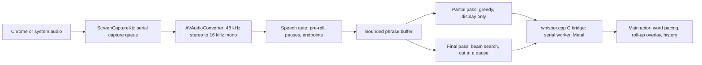

# Soundveil

*Give sound a written form.*

A native SwiftUI macOS app for offline English captions of Chrome videos and live streams. MIT licensed, no account, subscriptions, paid APIs, translation, or microphone capture. Model downloads and the launch-time update check require internet; recognition does not. The Apple operating system and SDK remain proprietary prerequisites.

## Run the built app

Open `dist/Soundveil.app` in Finder. This locally built app is ad-hoc signed, not notarized. Keep it in a stable location so recording permissions remain associated with it.

1. Open Chrome and play a video. Mute other audible Chrome tabs.
2. Choose a recognition model, then **Download model (free)**. **Large v3 Turbo** is the default and needs 1.6 GB of disk space; [Choosing a model](#choosing-a-model) covers the others. Downloads stream to disk, support cancellation, and install only after completion and a GGML header check. Files are not cryptographically verified by this MVP.
3. Select **Chrome (all audible tabs)** and **Start captions**.
4. Accept macOS's native recording-permission prompt. Depending on macOS, the setting is named **Screen Recording** or **Screen & System Audio Recording** under **System Settings → Privacy & Security**. Enable Soundveil and relaunch if requested. The app uses ScreenCaptureKit's native authorization flow; it cannot grant itself access.
5. Drag the caption panel to your preferred position. Pointing at the panel shows its controls: smaller and larger text, expand, click through, and hide. Resize it from an edge or the corner grip; a larger panel shows more lines. **Expand** grows it upward for reading back, including text that has already faded. Size, position, and text size are remembered, and **Window → Reset Caption Overlay** restores the default. It floats above ordinary windows and requests full-screen/Spaces participation; exclusive full-screen applications may behave differently.
6. Stop before changing source, model, or quiet-speech threshold. Stop keeps the words already shown and waits for any current inference call to finish before unloading the model.

Captions roll up from the bottom of the panel. Words appear about a third of a second after they are spoken, dimmed while they may still change, and turn solid once two recognition passes agree. When the speaker pauses, the phrase is finalized and may be corrected slightly. The status line shows how far behind live the captions are.

Sound words ("haha", "whoa", "kaboom") and internet slang ("bruh", "no cap") appear in a warm accent, slightly larger, with a brief pop. Everyday words only count when shouted, so "Boom!" stands out and "the baby boom" does not. Laughter, applause, and music can appear as a small labeled pill when Whisper reports them. Turn word highlighting off with **Highlight sound words and slang**; pills stay on, as they describe sound rather than style it.

The level indicator shows captured audio. If it stays empty, check Chrome playback, permissions, or try **System audio**. System mode includes other applications' sounds, excluding Soundveil itself. No BlackHole/loopback driver is required. ScreenCaptureKit needs a display-based filter even for audio capture; the app subscribes only to audio and never saves screen images.

Models are stored at:

```text
~/Library/Application Support/FreeCaptions/Models/
  ggml-base.en.bin
  ggml-small.en.bin
  ggml-large-v3-turbo-q5_0.bin
  ggml-large-v3-turbo.bin
  ggml-large-v3.bin
```

The original `FreeCaptions` storage directory is retained for compatibility with existing downloads.
Soundveil has a new app identity; macOS may request recording permission again even
if you previously granted it to FreeCaptions.

Use **Open model folder** to install compatible GGML files manually or remove them to reclaim space. Model files are ignored by Git. Existing files are checked by whisper.cpp when loaded. History is kept in memory (latest 2,000 segments), reset on Start, and saved only when you choose **Export**. Quit discards it.

## Settings and shortcuts

Open **Soundveil → Settings** or the gear in the main window.

**Update speed** sets how often captions refresh, so you can suit your own Mac. A faster rate means less delay and more GPU and battery use. Automatic rests as long as each pass took, which keeps the GPU under about half load on any Mac, and slows down further in Low Power Mode or when the Mac is hot. A fixed choice is always honored. The change applies at once, even while captions are running.

**Keyboard shortcuts** work in every app, including while Chrome is in front, and need no extra permission. Click a shortcut to record a new one, or remove it. A shortcut needs ⌘, ⌃, or ⌥, or a function key, so it can't take over a key you type with. If macOS refuses one, another app is probably using it.

| Action | Default |
|---|---|
| Start or stop captions | ⌃⌥S |
| Show or hide overlay | ⌃⌥O |
| Expand or collapse overlay | ⌃⌥E |
| Larger text | ⌃⌥= |
| Smaller text | ⌃⌥- |
| Click through overlay | ⌃⌥T |
| Reset overlay | none |

**Click through** lets clicks pass to whatever is behind the overlay, so it can sit over video controls. The overlay can't be dragged or show its controls until this is off, so turn it off with the shortcut or in Settings.

## Choosing a model

Large v3 Turbo is the default. Smaller models use less memory, and Base and Small also run faster. Soundveil remembers your choice, and you can download more than one.

| Model | Download | Best for |
|---|---|---|
| Base | 148 MB | Older Macs or long battery life. Expect more mistakes, especially on names and fast speech. |
| Small | 488 MB | Macs where the Large models fall behind. More accurate than Base and still light. |
| Large v3 Turbo Compressed | 574 MB | Macs with 8 GB of memory. Close to Turbo's accuracy in much less memory. |
| Large v3 Turbo | 1.6 GB | Most Macs with 16 GB or more. The best balance of accuracy and speed. |
| Large v3 | 3.1 GB | Difficult audio, if you can accept captions running further behind. Needs far more memory. |

Only Large v3 Turbo has been measured with live captions. The rest of this table is guidance from the models' sizes and their general behaviour, not measurements. If captions fall behind, try a slower **Update speed** first, then a smaller model.

## Performance on other Macs

Soundveil only runs on Apple Silicon, so every supported Mac has a GPU. What varies is how fast it is, and memory: Large v3 Turbo needs about 1.9 GB while listening, which is a lot on an 8 GB Mac.

Slower Macs lose speed, not accuracy, and no audio is dropped. These figures come from `StreamCheck` on an M4 Pro, scaling each pass by the factor shown. They are simulations, not tests on those Macs.

| Speed compared with an M4 Pro | Update rate | GPU busy | Words appear after |
|---|---|---|---|
| Same | about 0.4 s | 49% | 0.6 s |
| Same, Low Power Mode or hot | about 0.8 s | 28% | 1.0 s |
| 3× slower | about 1.2 s | 59% | 1.8 s |
| 5× slower | about 2 s | 65% | 2.9 s |

Decoding on the CPU alone, which also works, was about 4.7× slower than the GPU on an M4 Pro.

## Reproducible build

Prerequisites: Apple Silicon, macOS 14+, full Xcode 16.2 or later with command-line tools selected, Git, and CMake 3.20+. The implementation was compiled against the installed macOS 15.2 SDK; it does not assume newer APIs are available. No developer subscription is required.

Run `./scripts/setup-signing.sh` once to create a self-signed code-signing identity in your login keychain. macOS stores the signing identity with the recording permission, so builds signed with it keep that permission. Without it, `build.sh` falls back to ad-hoc signing and warns, and every new build needs the recovery steps under [Updates](#updates). Your recording permission and updates depend on this key, so keep your keychain backed up. It is not an Apple-issued identity and does not change Gatekeeper trust.

```bash
# Install CMake if necessary using Homebrew:
brew install cmake
# From this project's directory:
./scripts/setup-signing.sh
./scripts/build.sh
./scripts/test.sh
open dist/Soundveil.app
```

`build.sh` fetches whisper.cpp v1.8.7 and verifies commit `48f628a84833905ee4a0658ee6d4a5c915ce1997`. It builds static ARM64 libraries with Metal, embedded Metal shaders, and Accelerate, then builds and signs the app. Subsequent builds reuse the local checkout. No inference server or process-per-chunk is used. For editing, open `Package.swift` in Xcode after the dependency build; use the script-built app bundle for permission/playback testing. The package uses Swift 5.10 language mode, tested with Swift 6.0.3.

## Build a drag-and-drop DMG

```bash
./scripts/package-dmg.sh
# Or package the app you already built:
./scripts/package-dmg.sh --skip-build
```

The script creates `dist/Soundveil-0.1.0-arm64.dmg` (version read from the app),
plus a `.sha256` checksum. It contains `Soundveil.app`, an `Applications` shortcut,
and installation instructions. Open the DMG, drag the app onto Applications,
eject the image, and launch the installed app. Models download separately.

This build has no Apple Developer ID and is not notarized.
Creating a DMG does not change macOS Gatekeeper trust. A normal public release
requires a separate Developer ID signing and Apple notarization workflow;
see [Apple's distribution guidance](https://developer.apple.com/documentation/security/notarizing-macos-software-before-distribution).
The packaging script verifies the app signature and disk-image integrity, but does
not perform notarization or upload a GitHub release.

## Updates

Soundveil does not install updates itself. At launch it asks the GitHub Releases API
for this repository's latest published release; the request contains no captions,
audio, or settings. If that release's tag is newer than the running version, the main
window shows a banner whose **Download** button opens the disk image in your browser.
Replace the app in Applications with the new one. **Soundveil → Check for Updates…**
checks on demand and reports the result; **Check for Updates Automatically** turns the
launch-time check off. Drafts and prereleases are never offered, and automatic-check
failures are silent.

macOS stores the app's signature with the recording permission. Moving from one
signing identity to another, or between ad-hoc builds, can leave the switch in System
Settings on while capture is refused. Turning it off and on does not help. To recover,
run `tccutil reset ScreenCapture org.soundveil.mac`, click **Start captions**, turn
Soundveil on again, and reopen it. Signed, in-place updates (for example with Sparkle) would
require Developer ID signing and notarization.

To publish a release, bump the last number of `CFBundleShortVersionString` in
`Info.plist` (0.1.0 → 0.1.1; minor and major bumps are deliberate decisions), commit,
and push, then run:

```bash
./scripts/release.sh
```

It refuses to run with uncommitted or unpushed changes, an existing tag, or a version
older than the latest release. It builds and packages the DMG, then creates the
`vX.Y.Z` GitHub release with the DMG and checksum attached. Pass `--skip-build` to
package the app already in `dist/`. Requires the GitHub CLI (`gh`), signed in.

## Pipeline and concurrency



Whisper has no native streaming, so this follows the approach of [Whisper-Streaming](https://arxiv.org/abs/2307.14743) and [WhisperKit](https://arxiv.org/abs/2507.10860): re-decode growing audio, show a fast hypothesis, and confirm text as it stabilizes.

- Capture and conversion use one serial queue. Inference and context destruction use another; model loading never blocks the main actor. A lock protects the transcriber state they share. UI work runs on the main actor. C pointers never cross into UI code.
- **Partial passes** run over the current phrase one at a time, paced by the update speed. They use greedy decoding and exist only for display. Passes that find no words, as with music or noise, wait progressively longer, up to 2 s.
- **The screen changes only when two passes in a row agree.** Whisper's guess at a cut-off phrase can swing wildly between passes, so a lone outlier is ignored. New words at the end are the exception: one is shown ahead of agreement to keep up.
- **Final passes** use beam search over the whole phrase and produce the transcript. A phrase ends at a pause of 200 ms once it is at least 2.5 s long, or at any 600 ms silence. Pauses are measured against the speaker's recent level, so they are still found over a noise floor. A run with no pause is cut at its quietest point after 9 s.
- **Audio is cut at pauses because Whisper's word timestamps are not reliable enough to cut on**: they bunch at the end of the audio, and cutting on them lost whole phrases. Alignment-based timestamps (DTW) were accurate but more than doubled the cost of a pass.
- **No prompt is passed to Whisper.** Earlier text echoed into the transcript and made it invent phrases (18.8% word error against 1.0% without), and unpunctuated text removed punctuation for good.
- **The audio context is fixed at 640** rather than Whisper's 1500, about 3 s of headroom over the longest phrase. The encoder dominates the cost and scales with it. It must not vary between passes: mixing sizes in one whisper context made the passes that followed collapse into nonsense.
- Phrases with under 250 ms of speech are not decoded, because Whisper invents text from silence. Tokens per pass are capped and repeated phrases are cut, which stops Whisper's loops.
- If inference stalls, phrases awaiting a final pass are bounded at 24 s and the oldest is dropped. This bounds latency and memory **by deliberately losing coverage**, and the status line reports the seconds skipped. Partial passes always take the newest audio, so they cannot build a backlog.
- The overlay places each word once from the words before it, so appended words never move text already on screen. Words fade in and a batch is staggered over about 0.3 s so it reads as a flow. Captions fade after eight seconds without new text, and stay available to Expand.
- Word highlighting uses short, fixed word lists on the device, on the principle that when everything stands out nothing does. Fillers stay plain. Non-speech cues are allowed on final passes only, so they cannot make partial text flicker, and only laughter, applause, cheering, and music are shown.

## Quality, latency, and limitations

Large v3 is the quality-oriented option; Turbo reduces decoding cost. Neither guarantees correct recognition of muffled, fast, accented, overlapping, or music-obscured speech. Source captions, if accurate and available, remain preferable to ASR. No denoising or source separation is included: aggressive filters can remove speech detail, and those features need separate evaluation.

`VALIDATION.md` has measured latency. Words on screen can still change until their phrase is finalized, usually within a few seconds. Noise that hides pauses makes phrases longer, which slows finalization and raises the error rate. Model loading can take up to a minute the first time a build runs, while macOS compiles the Metal shaders; later loads take seconds. Large models need several GB of working memory beyond download size. 16 GB or more unified memory is a practical starting recommendation, not a measured minimum. Only Large v3 Turbo has been benchmarked with this pipeline. Heat, Chrome playback, and other GPU work affect throughput.

Chrome mode captures the application, **not an individual tab or window's independent audio track**. macOS window selection does not reliably provide per-tab audio isolation. Chrome Beta/Canary bundle identifiers under `com.google.Chrome.*` are included. Protected/DRM content may be silent or unavailable. Chrome helper audio routing, fullscreen placement, sleep/wake, and display changes need interactive verification on your Mac; restart capture after a display/source interruption.

The overlay has a transparent window with a translucent dark caption background, white scalable text, and accessibility labels. The full text remains in history, grouped into sentences. This version has no neural VAD, automatic reconnect, download resume, or background transcript persistence.

## Optional Core ML encoder

Metal is enabled and sufficient for the default build. To compile the optional Core ML bridge:

```bash
COREML=ON ./scripts/build.sh
COREML=ON ./scripts/test.sh
```

You must separately generate a matching compiled encoder following the [pinned upstream Core ML instructions](https://github.com/ggml-org/whisper.cpp/tree/v1.8.7#core-ml-support). They recommend Python 3.11 with `ane_transformers`, `openai-whisper`, and `coremltools`, then `models/generate-coreml-model.sh MODEL_NAME`. Put `ggml-large-v3-encoder.mlmodelc` or `ggml-large-v3-turbo-encoder.mlmodelc` beside its matching `.bin` file. Conversion downloads extra weights and consumes substantial disk/memory. Do not substitute an encoder from another model. Conversion compatibility and Neural Engine performance are not validated here. Re-run the default build to return to Metal-only. Core ML is optional; it is not automatically downloaded or enabled by the UI.

## Validation and manual acceptance

See `VALIDATION.md` for checks actually performed. Run the automated core tests after changes:

```bash
./scripts/test.sh
```

Native checks run without recording permission. `StreamCheck` replays a recording through the rolling pipeline on a simulated live clock, using the real model, and reports caption delay, on-screen changes, and word error against an optional reference text. It does not exercise ScreenCaptureKit, the overlay, or real playback. `SmokeCheck` exercises the C bridge and AVAudioConverter.

```bash
# Supply any compatible local GGML model; tiny.en is sufficient for plumbing checks.
CLANG_MODULE_CACHE_PATH="$PWD/.build/ModuleCache" \
  swift run --disable-sandbox --cache-path "$PWD/.build/cache" \
  SmokeCheck /absolute/path/ggml-tiny.en.bin vendor/whisper.cpp/samples/jfk.wav
# After build.sh, with an optional reference transcript and show=1 for a timeline:
.build/release/StreamCheck /absolute/path/ggml-large-v3-turbo.bin vendor/whisper.cpp/samples/jfk.wav
```

For manual acceptance, test permission denial/retry, Chrome and system capture, mute/unmute, quiet speech, fast/accented clips, long continuous speech, repeated words, switching models after Stop, canceling a download, fullscreen/Spaces, and stopping during inference. Verify caption lag and skipped-window count during a ten-minute stream. No automated test can establish recognition quality for your content without representative audio and a reference transcript.

## Source files

- `Package.swift`: Swift package, static native linkage, optional Core ML linkage.
- `Info.plist`: app identity, deployment target, recording usage description.
- `Sources/CaptionCore/Pipeline.swift`: speech gate, pause detection, words, sentence grouping.
- `Sources/CaptionCore/Rolling.swift`: rolling transcriber, display agreement, word placement, pacing.
- `Sources/CaptionCore/Expressive.swift`: sound word, slang, and non-speech cue detection.
- `Sources/CWhisperBridge/include/Bridge.h`, `Sources/CWhisperBridge/Bridge.c`: narrow native inference API.
- `Sources/WhisperEngine/Recognizer.swift`: decodes a job and rebuilds words from Whisper's tokens.
- `Sources/Soundveil/App.swift`: SwiftUI controls, session lifecycle, history/export.
- `Sources/Soundveil/Overlay.swift`: word feed, roll-up captions, hover controls, and resize grip.
- `Sources/Soundveil/Settings.swift`, `Sources/Soundveil/Hotkeys.swift`: settings window, shortcut recorder, and global shortcuts.
- `Sources/ShortcutCore/Shortcuts.swift`: shortcut actions, defaults, validation, and storage.
- `Sources/Soundveil/Capture.swift`: ScreenCaptureKit, PCM extraction, resampling, discontinuity handling, audio level.
- `Sources/Soundveil/Inference.swift`: model worker and caption delivery.
- `Sources/Soundveil/Models.swift`: model choices, local storage and download progress/cancellation.
- `Sources/Soundveil/Updates.swift`: GitHub latest-release request.
- `Sources/UpdateCore/Release.swift`: release-tag version parsing, ordering, and response decoding.
- `Sources/SmokeCheck/main.swift`: offline native inference smoke test.
- `Sources/StreamCheck/main.swift`: offline latency and accuracy harness.
- `Tests/CaptionCoreTests/`: pipeline, rolling transcriber, overlay layout, and expressive word unit tests.
- `Tests/ShortcutCoreTests/ShortcutTests.swift`: shortcut unit tests.
- `Tests/UpdateCoreTests/ReleaseTests.swift`: version and release-response unit tests.
- `scripts/build.sh`, `scripts/test.sh`: reproducible build/package/sign and test commands.
- `scripts/setup-signing.sh`: creates the local signing identity.
- `scripts/package-dmg.sh`, `scripts/release.sh`: disk-image packaging and GitHub release publishing.
- `README.md`, `VALIDATION.md`, `LICENSE`, `.gitignore`: documentation, evidence, MIT license, generated-artifact exclusions.
- `vendor/whisper.cpp/`: downloaded upstream source and its own license, excluded from Git.
- `.build/`, `dist/`: generated build products; `dist/Soundveil.app` is the user-facing app.

## References and licenses

[Apple ScreenCaptureKit](https://developer.apple.com/documentation/screencapturekit) and the installed SDK headers informed capture integration. Apple recommends its content-sharing picker for user-selected screen/window workflows; this app instead uses an explicit Chrome/system application filter and the normal recording-permission flow. [whisper.cpp v1.8.7](https://github.com/ggml-org/whisper.cpp/tree/v1.8.7) provides the MIT-licensed local inference engine. [GGML model distribution](https://huggingface.co/ggerganov/whisper.cpp) supplies downloadable converted weights. Upstream model licenses apply separately. Bundled app resources include this project's and whisper.cpp's licenses.
